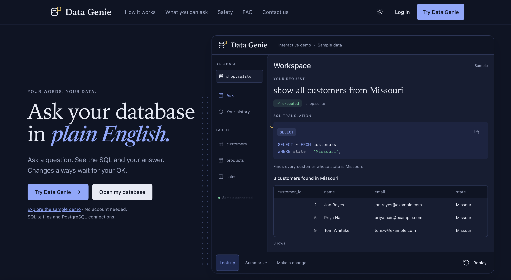
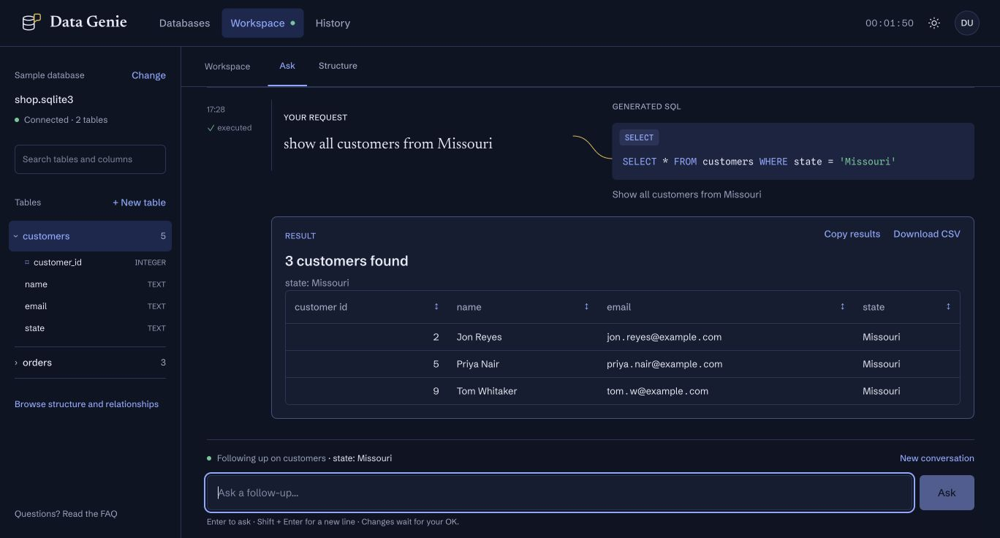

# Data Genie

Ask your database questions in plain English. Use a SQLite file or connect PostgreSQL, see the SQL and results, then ask a follow-up. Reads run immediately; changes always wait for your confirmation.

[Open Data Genie](https://data-genie-blueray321.azurewebsites.net/) · [Log in](https://data-genie-blueray321.azurewebsites.net/signin) · [Sign up](https://data-genie-blueray321.azurewebsites.net/signup) · [FAQ](https://data-genie-blueray321.azurewebsites.net/faq)



## The workspace

- Upload a SQLite file, connect PostgreSQL, create an empty database, or explore the sample.
- Ask questions using Gemini, or write SQL without an API key. The SQL tab includes examples.
- Add, rename, or delete tables and columns in Structure, with a SQL preview before each change.
- Sort, copy, or export results as CSV, and revisit saved requests in History.
- Keep writing from the bottom editor; browse recent requests in small batches and search the full History by page.
- Open Account and saved History even when no database is connected.



Built with React, Vite, Python, and SQLite. Screenshots use sample data.

## Folders

```text
frontend/   React pages, components, styles, and Vite configuration
backend/    Python services, database connectors, and server
azure/      Terraform, deployment pipeline, and cloud requirements
tests/      Python tests; React tests live beside the frontend
scripts/    Local startup, demo data, and deployment helpers
docs/       Guides, design notes, and screenshots
backup/     Private local recovery copies, excluded from Git
db/         Local accounts, history, and working databases, excluded from Git
```

## Run locally

You'll need Python 3.9+ and Node.js 22.12+.

```bash
git clone --branch dev https://github.com/blueraymusic/Data-Genie.git
cd Data-Genie
npm install
npm run build
npm start
```

For local development, open the address printed by `npm start`, sign up, and choose a database.

`npm start` uses the project's `.venv` when available, so PostgreSQL runs with the connector packages installed there. `npm run dev` starts the frontend only; keep the server running too.

If port 8000 is busy, run `npm start -- 8001`.

For live frontend updates, leave the Python server running and start Vite in another terminal:

```bash
npm run dev
```

Open the URL Vite prints. It forwards API requests to the Python server.

## Optional Gemini setup

Copy `.env.example` to `.env` and add your `GEMINI_API_KEY`. The model is configured with `GEMINI_MODEL` in the same file. Without a key, use the SQL tab or the forms in Structure. Neither sends requests to AI.

Gemini receives the database structure and recent conversation context, including request text, SQL, and clarifications. Result rows are not sent to the model.

## Connect PostgreSQL

With Python 3.10+, install the optional connector in a virtual environment:

```bash
python3 -m venv .venv
source .venv/bin/activate
pip install -r backend/requirements-postgres.txt
npm start
```

Restart the server with that environment, then choose **Databases → PostgreSQL**. Paste your connection URL, choose a schema, and test it. Connections start read-only. Enable **Allow changes after I confirm them** to review and confirm edits to the live database. Connection settings are encrypted in the Data Genie installation.

Confirmed edits are saved in PostgreSQL directly; no download or upload is needed. CSV downloads are copies of result rows. This is a direct PostgreSQL connector; an MCP client or server is not included yet.

See the [FAQ](https://data-genie-blueray321.azurewebsites.net/faq) for common questions, or [database connections](docs/database-connections.md) for setup and testing.

For a local test database, run `.venv/bin/python scripts/postgres_demo.py start`. It creates sample customers, products, and orders on port 55432. The connection URL is saved privately in `db/postgres-demo/connection.txt`.

## Host on Azure

[Open the hosted app](https://data-genie-blueray321.azurewebsites.net/). Create a hosted account; desktop accounts stay separate.

The [Azure deployment guide](docs/azure-free-hosting.md) covers the Terraform variables, Azure DevOps pipeline, and storage limits. Hosting supports free F1 or one budgeted Linux B1 instance using student credit. Azure SQL stays on its free offer and pauses at its limits. Existing local accounts and databases are not uploaded automatically.

## Checks

```bash
npm test
python3 -B -m unittest
```

Accounts and history stay with the Data Genie installation, with hashed passwords. Local databases and API keys are excluded from Git. See [SECURITY.md](SECURITY.md) for security details.
