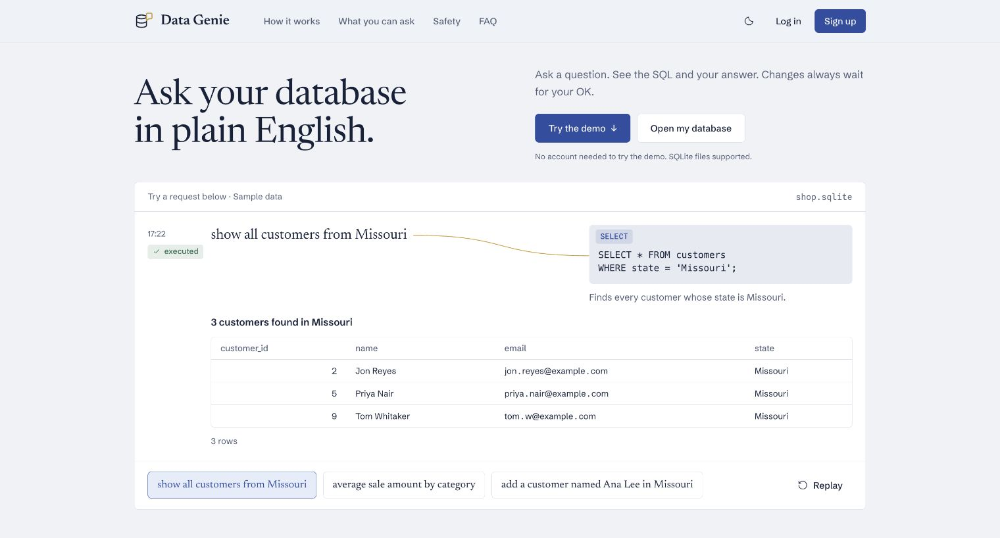
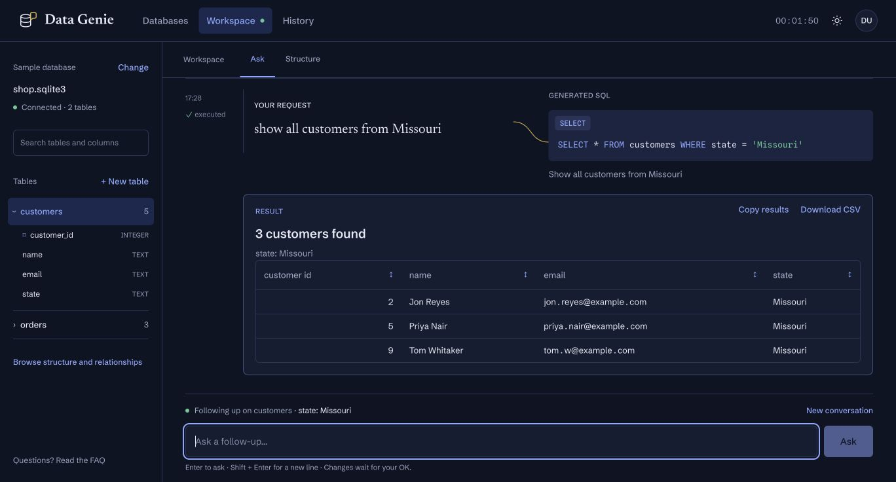

# Data Genie

Ask your database questions in plain English. Use a SQLite file or connect PostgreSQL, see the SQL and results, then ask a follow-up. Reads run immediately; changes always wait for your confirmation.



## The workspace

- Upload a SQLite file, connect PostgreSQL, create an empty database, or explore the sample.
- Ask questions using Gemini or use Keywords mode without an API key.
- Browse tables and columns, and review SQL before confirming changes.
- Sort, copy, or export results as CSV, and revisit saved requests in History.



Built with React, Vite, Python, and SQLite. Screenshots use sample data.

## Run locally

You'll need Python 3.9+ and Node.js 22.12+.

```bash
git clone https://github.com/blueraymusic/Data-Genie.git
cd Data-Genie
npm install
npm run build
python3 -B server.py
```

Open [localhost:8000](http://localhost:8000), sign up, and choose a database.

For live frontend updates, leave the Python server running and start Vite in another terminal:

```bash
npm run dev
```

Open the URL Vite prints. It forwards API requests to the Python server.

## Optional Gemini setup

Copy `.env.example` to `.env` and add your `GEMINI_API_KEY`. The model is configured with `GEMINI_MODEL` in the same file. Without a key, choose Keywords in Account & preferences.

Gemini receives the database structure and recent conversation context, including request text, SQL, and clarifications. Result rows are not sent to the model.

## Connect PostgreSQL

With Python 3.10+, install the optional connector in a virtual environment:

```bash
python3 -m venv .venv
source .venv/bin/activate
pip install -r requirements-postgres.txt
python3 -B server.py
```

Restart the server with that environment, then choose **Databases → PostgreSQL**. Paste your connection URL, choose a schema, and test it. Connections start read-only. Enable **Allow changes after I confirm them** to review and confirm edits to the live database. Credentials are encrypted locally.

Confirmed edits are saved in PostgreSQL directly; no download or upload is needed. CSV downloads are copies of result rows. This is a direct PostgreSQL connector; an MCP client or server is not included yet.

See the [FAQ](http://localhost:8000/faq) for common questions, or [database connections](docs/database-connections.md) for setup and testing.

For a local test database, run `.venv/bin/python scripts/postgres_demo.py start`. It creates sample customers, products, and orders on port 55432. The connection URL is saved privately in `db/postgres-demo/connection.txt`.

## Checks

```bash
npm test
python3 -B -m unittest
```

Accounts and history are stored locally, with hashed passwords. Local databases and API keys are excluded from Git. See [SECURITY.md](SECURITY.md) for security details.
