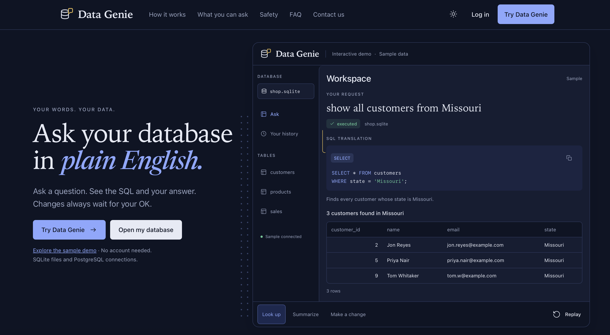

# Data Genie

Give people and agents scoped access to your databases, with human review before changes run. Ask in plain English, inspect SQL and charts, and follow up. Use SQLite or connect PostgreSQL.

[Open Data Genie](https://data-genie.space/) · [Log in](https://data-genie.space/signin) · [Sign up](https://data-genie.space/signup) · [FAQ](https://data-genie.space/faq)



## What you can do

- Ask questions or run SQL directly.
- Manage tables and columns with a preview before changes.
- Work with a team, grant database access, and transfer a team workspace you own with recipient approval. Personal workspaces cannot be transferred.
- Verify new hosted accounts with a five-minute email code (three attempts).
- Coedit report drafts live, share reviewed findings, and download PDFs.
- Connect an agent through MCP or the HTTP API.
- See workspace, database, access, and report updates without refreshing.
- Export each database's current state, move it between workspaces you own, or remove it.

## Start locally

Use Node.js 22.12+ and Python 3.11+ for the full application.

```bash
git clone --branch dev https://github.com/blueraymusic/Data-Genie.git
cd Data-Genie
python3 -m venv .venv
.venv/bin/python -m pip install -r requirements.txt
npm install
npm run build
npm start
```

Open the address printed by the server and create an account. Hosted and local accounts are separate. For live frontend updates, keep the server running and run `npm run dev` in another terminal.

## Find your guide

| Part | Guide |
| --- | --- |
| Using the app, teams, and reports | [User documentation](docs/README.md) |
| Account creation and password recovery | [Account walkthrough](docs/account-lifecycle.md) |
| React UI and local development | [Frontend](frontend/README.md) |
| Python services and HTTP API | [Backend](backend/README.md) |
| Hosted MCP, OAuth, and the local bridge | [Agent connections](agents/README.md) |
| Terraform, deployment, and hosting | [Azure](azure/README.md) |
| Running checks | [Tests](tests/README.md) |
| Credentials and reporting vulnerabilities | [Security](SECURITY.md) |

Browser-based MCP clients use `https://data-genie.space/mcp`, then sign in and choose a workspace and permissions. Scripts can use workspace-scoped API keys. See the [connection steps](docs/agents.md).

Built with React, Vite, Python, and SQLite. Local databases, accounts, and secrets are excluded from Git.
