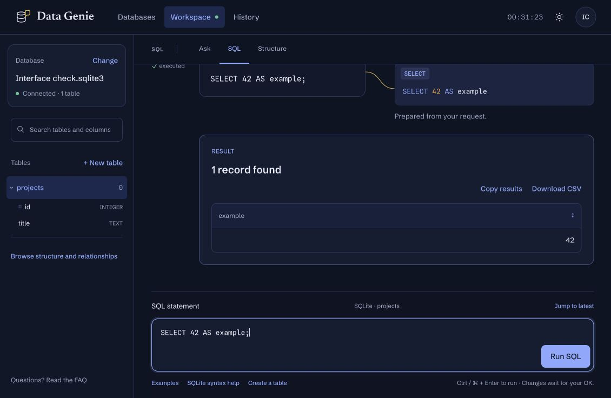

# Using Data Genie

[Open Data Genie](https://data-genie.space/) · [FAQ](https://data-genie.space/faq)

Sign up or log in, then choose a database. You can create an empty SQLite database, upload a SQLite file, try the sample, or connect PostgreSQL. Hosted accounts and laptop accounts are separate.

## Start alone or with a team

Your **Personal workspace** keeps your databases private. To work together, choose **Create team workspace** on **Choose your database**, enter a **New workspace name**, and choose **Create workspace**. You do not need to open a database first. The app opens the new team in **Teams**, ready to add a database and invite people.

The same action is available on **Databases** while a database is open. Creating a team keeps that connection and does not move its database. In **Teams**, use **Databases** to add or open a database and **People & access** to invite teammates and grant access. See [workspaces and access](workspaces.md) for the private invitation-code steps and permissions.

## Choose how to work

| View          | Use it for                                                                                |
| ------------- | ----------------------------------------------------------------------------------------- |
| **Ask**       | Describe a request in plain English using Data Genie AI, then inspect its SQL and result. |
| **SQL**       | Write one SQL statement directly, without an AI service or API key.                       |
| **Structure** | Inspect tables and columns, or use forms to change their structure.                       |
| **History**   | Search saved requests and reopen their SQL and result snapshots.                          |

## Ask in plain English

In the sample database, start with **show all customers**, then ask **which ones are in Iowa**. Data Genie uses the database structure and recent conversation to interpret follow-ups. If it needs more detail, answer its question in the same conversation.

Press **Enter** to ask or **Shift + Enter** for a new line. **New conversation** clears the context for future requests and keeps saved History.

Data Genie AI sends your request, database structure, and recent conversation facts to the configured AI service. Result rows and saved connection credentials are not sent. Values you type into a request are included. If AI is unavailable, open SQL or Structure to continue.

## Run SQL

The SQL editor and **Run SQL** button stay at the bottom while results scroll above. Use **Ctrl/⌘ + Enter** to run; plain Enter adds a line. **Examples** fills the editor without running anything, and **Syntax help** explains the connected database's syntax.

For the sample database:

```sql
SELECT name, state
FROM customers
WHERE state = 'Missouri';
```

Use one statement at a time. A trailing semicolon is optional. Reads run immediately. Writes are prepared for review and require confirmation. PostgreSQL statements must use the connected schema, and read-only connections cannot prepare writes.



## Edit tables and columns

Open **Structure**. **Create table** starts a table with a generated `id` primary key. Then use **Add column** and choose its name and type. Each table also has **Rename table** and **Delete table**; each column has **Rename** and **Delete** where supported.

The forms prepare SQL rather than applying changes immediately. Review the pending change, then confirm it or choose **Don’t run**. Dropping a table also requires typing its name. Database constraints can prevent a change. Existing data types and constraints are shown for inspection; the forms do not convert existing column types.

The Structure toolbar stays available while scrolling. Use **Jump to table** to move directly to a table. The last completed change stays collapsed so it does not bury the table controls.

Choose **Sample rows** on a table to inspect its data. **Hide sample rows** closes the preview; opening it again reuses the loaded rows. Choose **Refresh sample rows** while it is open to fetch current data. Changing sessions or refreshing the schema clears the samples. Copy and CSV controls follow your database's download permission, including in these previews.

## Navigate long conversations and History

- Ask and SQL initially show eight recent requests. **Show earlier requests** opens older batches, and **Jump to latest** returns to current work. Older completed results stay collapsed until opened; pending confirmations remain available.
- The workspace caches the latest 50 requests plus unresolved changes. Open **View all in History** for the full saved record; leaving the recent cache does not delete a request.
- History loads 20 requests per page. Its search and page controls stay available while scrolling. **Next** opens older requests, **Previous** returns toward newer ones, and **Newest** returns to the first page.
- Type your words or SQL and choose **Search**. Expand **Session & operation** to change the session or SQL operation. Choosing an operation applies it immediately and returns to the first page; any search text you have not submitted stays in the field.
- **Clear filters** beside Search resets the search and operation. Emptying the search field removes its applied search immediately.
- Open an entry's details to load its SQL and saved result. **Use request** prepares it in the current database; it does not silently rerun it.

Saved results are snapshots, with up to 500 rows. Run a request again for current data. Additional result pages read current data without changing the saved snapshot. CSV exports contain the rows currently loaded in the result.

## Know where changes are saved

SQLite uploads use a server-side working copy; download the updated SQLite file from Account to keep a copy outside Data Genie. PostgreSQL is a live connection: confirmed edits affect that database directly, and other applications can see them. Ending a session does not undo a change.

There is no automatic undo. Keep backups before changes you may need to reverse. If a write reports that its outcome could not be saved, check History and the connected database before retrying it.

See [database connections](database-connections.md), [security and privacy](../SECURITY.md), and [Azure hosting](azure-free-hosting.md) for setup and deployment details.
