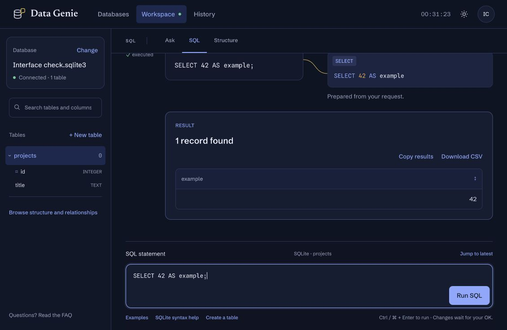

# Using Data Genie

[Main README](../README.md) · [All guides](README.md) · [Agent connections](agents.md)

[Open Data Genie](https://data-genie.space/) · [FAQ](https://data-genie.space/faq)

Sign up or log in, then choose a database. You can create an empty SQLite database, upload a SQLite file, try the sample, or connect PostgreSQL. Hosted accounts and laptop accounts are separate. The [account walkthrough](account-lifecycle.md) explains verification, the personal workspace, invitations, and password recovery step by step.

On your first visit to **Databases** after creating an account, the walkthrough highlights controls across **Databases**, **Workspace**, **History**, **Teams**, and **Account**. Use **Next** and **Previous** to move between highlights. The walkthrough uses sample data. To replay it, choose **Take the walkthrough** below **Default workspace view** in **Account & preferences**.

Open screens update automatically while visible, and check for changes when you return to the tab. Database lists, workspace membership, permissions, reports, Structure, open row previews, and History update without reloading the page. Saved SQL results remain snapshots; run a query again to get a new answer.

## Start alone or with a team

Your **Personal workspace** keeps your databases private. To work together, choose **Create team workspace** on **Choose your database**, enter a **New workspace name**, and choose **Create workspace**. You do not need to open a database first. The app opens the new team in **Teams**, ready to add a database and invite people.

The same action is available on **Databases** while a database is open. Creating a team keeps that connection and does not move its database. In **Teams**, use **Databases** to add or open a database and **People & access** to invite teammates and grant access. See [workspaces and access](workspaces.md) for the private invitation-code steps and permissions.

Teams uses the available screen width. On phones, use **Select workspace** to switch teams. Database lists show two items per page, with search and page controls once there are more than two. **Manage** opens a popup for one database. **People & access** opens a popup with separate **Database access**, **Workspace role**, and **Invitations** views; choose a person and one database instead of scrolling through every permission. Your unsaved permission choices stay while you switch people, databases, and views. Pages use normal document scrolling; long report editing uses one popup scroll area, with editors that grow to fit their text.

## Connect an agent

Use `https://data-genie.space/mcp` in a client supporting custom remote MCP with OAuth. Sign in, review the callback address, and choose one workspace and the actions you want to allow. Your current permissions still apply. SQL edits wait for your review in Data Genie; reports stay private drafts. Revoke a connection in **Account → Agents & API**. For scripts and API keys, see the [agent guide](agents.md).

## Your account

On the hosted site, email signup sends a six-digit verification code. Signup and login also offer **Continue with Google**. Codes expire after **five minutes** and allow **three incorrect attempts**. A replacement code invalidates the previous one; resends have a one-minute cooldown and rate limits. The account is created only after verification. Existing accounts can still log in.

Password checks allow three failures per account within a 15-minute window. Choose **Forgot password?** on Log in to request recovery instructions. Every address receives the same on-screen response; eligible password accounts receive a single-use link valid for 15 minutes when email delivery is configured. After mailbox verification, signup with an existing email offers login or password reset without replacing that account.

Open **Account & preferences** from your user menu. **General** shows your name, email, account creation date, sign-in methods, light/dark appearance, and default workspace view. General and Sign-in & security sit together on desktop; they stack on smaller screens. Choose **Edit profile** to update your name or photo, then **Save changes**. PNG, JPEG, and WebP photos up to 5 MB are cropped to a square and resized on your device before upload. Removing a photo restores your initials. Email stays unchanged because it identifies your login and workspace invitations.

**Sign-in & security** contains password settings. Changing your password signs out other browser sessions and revokes agent access. **Agents & API** has the MCP server URL, API endpoint, and connection controls. Agent connections load only when you open that panel.

Ownership transfer is separate from deletion and applies only to **team workspaces you own**. Your Personal workspace cannot be transferred. In **Teams → Workspace settings → Transfer ownership**, enter an existing account’s email and send a request. The recipient reviews it in **Teams → Ownership requests** and accepts or declines. You keep control until acceptance. Sending a transfer request does not delete your account. See [transfer steps](workspaces.md#transfer-ownership).

**Delete account** opens an impact review. Confirm your email, type **DELETE**, and enter your current password. Google-only accounts must have signed in again within five minutes. Deletion removes your remaining owned Data Genie database copies, connections, private history, logins, invitations, pending transfers, and agent access. Finish any desired transfer in Teams first; move personal databases into a team before transferring them.

Reports remain in read-only archives for remaining members, preserving existing visibility. Anyone who can view an archived report can delete it. Workspaces without remaining members are deleted with their reports. External PostgreSQL servers are never dropped. See [retention details](workspaces.md#delete-account).

## Choose how to work

| View          | Use it for                                                                                |
| ------------- | ----------------------------------------------------------------------------------------- |
| **Ask**       | Describe a request in plain English using Data Genie AI, then inspect its SQL and result. |
| **SQL**       | Write one SQL statement directly, without an AI service or API key.                       |
| **Structure** | Inspect tables and columns, or use forms to change their structure.                       |
| **History**   | Search saved requests and reopen their SQL and result snapshots.                          |

## Ask in plain English

In the sample database, start with **show all customers**, then ask **which ones are in Iowa**. Data Genie uses the database structure and recent conversation to interpret follow-ups. If it needs more detail, answer its question in the same conversation.

Press **Enter** to ask or **Shift + Enter** for a new line. **New conversation** clears the context for future requests and keeps saved History.

Data Genie AI sends your request, database structure, and recent conversation facts to the configured AI service. Result rows and saved connection credentials are not sent automatically. Values you type into a request are included. If AI is unavailable, open SQL or Structure to continue.

### Charts in answers

Ask **Show me the monthly sales trend for the last 12 months**, naming your actual sales table and date/amount fields when needed. Data Genie can return a line chart for a trend or a bar chart for a grouped comparison. The model chooses a structured chart specification; only real SQL result values supply the chart. It cannot generate frontend code. **Chart** and **Table** let you switch views, and **View chart data** preserves exact values and CSV export. Invalid fields or values outside the safe plotting range stay in a table. A partial result is labeled; load more rows from its data table to extend the chart.

### Attach reference files

Choose **Attach PDF or image** beside the Ask composer, or drop files onto the composer. You can add up to two PDFs, PNGs, JPEGs, or WebP images, up to 4 MB combined. Type what you want to know, then choose **Ask**. Files are sent to the configured AI service only with that request. They are not stored in History or automatically reused on later turns; attach them again if needed. Generated SQL and summaries may still contain information from a file. File contents never bypass database permissions or change confirmations.

## Reports

In **Teams**, select a workspace and open **Reports**. Reports open in a full-screen view with a fixed Close button and save controls. Switch between **Write** and **Preview** without losing your text; the word count updates as you write. Create a blank report, use the template, or generate a draft from source notes you supply. Review AI text before saving. Members can edit their own drafts; only the owner can edit shared reports or share a report with all workspace members and viewers. Viewers get a reading surface without raw database access.

Save a new report once to enable live editing. Its author and the workspace owner can open the same unpublished draft and see each other's typing in about one second. Live working text syncs automatically; **Save report** updates the reviewed snapshot. Published readers continue to see the reviewed version until the owner saves. Wait for typing to sync before closing; preserve local text if the editor reports a connection problem. See [live collaboration and sharing](workspaces.md#write-together-live).

Anyone who can read a saved report can choose **Download PDF**, including viewers. In an active workspace, only its creator can choose **Delete report**, and only while they are a Member or Owner. Anyone who can view an archived report can delete it, including reports retained from a deleted author in an active workspace. Deletion asks for confirmation and is permanent.

## Run SQL

The SQL and Genie typing areas stay at the bottom of the workspace, with results and conversation above. Long drafts grow up to a bounded height, then scroll within the editor. Use **Ctrl/⌘ + Enter** to run; plain Enter adds a line. **Examples** fills the editor without running anything, and **Syntax help** explains the connected database's syntax.

For the sample database:

```sql
SELECT name, state
FROM customers
WHERE state = 'Missouri';
```

Use one statement at a time. A trailing semicolon is optional. Reads run immediately. Writes are prepared for review and require confirmation. PostgreSQL statements must use the connected schema, and read-only connections cannot prepare writes.



## Edit tables and columns

Open **Structure**. **Create table** starts a table with a generated `id` primary key. Then use **Add column** and choose its name and type. Each table also has **Rename table** and **Delete table**; each column has **Rename** and **Delete** where supported.

The forms prepare SQL rather than applying changes immediately. Review the pending change, then confirm it or choose **Don’t run**. Dropping a table also requires typing its name. Database constraints can prevent a change. Existing data types and constraints are shown for inspection; the forms do not convert existing column types.

The Structure toolbar stays available while scrolling. Use **Jump to table** to move directly to a table. The last completed change stays collapsed so it does not bury the table controls.

Choose **Sample rows** on a table to inspect its data. Open previews update automatically while visible. **Hide sample rows** closes the preview; opening it again reuses the loaded rows. Choose **Refresh sample rows** for an immediate check. Changing sessions clears the samples. Copy and CSV controls follow your database's download permission, including in these previews.

## Navigate long conversations and History

- Ask and SQL initially show eight recent requests. **Show earlier requests** opens older batches, and **Jump to latest** returns to current work. Older completed results stay collapsed until opened; pending confirmations remain available.
- The workspace caches the latest 50 requests plus unresolved changes. Open **View all in History** for the full saved record; leaving the recent cache does not delete a request.
- History loads 20 requests per page. Its search and page controls stay available while scrolling. **Next** opens older requests, **Previous** returns toward newer ones, and **Newest** returns to the first page.
- Type your words or SQL and choose **Search**. Expand **Session & operation** to change the session or SQL operation. Choosing an operation applies it immediately and returns to the first page; any search text you have not submitted stays in the field.
- **Clear filters** beside Search resets the search and operation. Emptying the search field removes its applied search immediately.
- Open an entry's details to load its SQL and saved result. **Use request** prepares it in the current database; it does not silently rerun it.

Saved results are snapshots, with up to 500 rows. Run a request again for current data. Additional result pages read current data without changing the saved snapshot. CSV exports contain the rows currently loaded in the result.

## Know where changes are saved

Confirmed database changes are saved automatically; there is no separate save step. SQLite uploads use a server-side working copy. PostgreSQL is a live connection: confirmed edits affect that database directly, and other applications can see them. Ending a session does not undo a change.

Downloads are limited to 100 MB; larger exports fail explicitly instead of silently truncating data. Each database card has a **Manage** button that opens a popup for that database. Its download links always export that database, independently of whichever database you last opened:

- **SQLite file:** a consistent snapshot including confirmed changes, suitable for reopening in Data Genie or another SQLite tool.
- **CSV folder (.zip):** all user tables plus schema metadata. Open CSV files in Excel or import them into another DBMS. SQLite includes `schema.sql`; PostgreSQL includes `schema.json`. CSV cannot preserve every database type or distinguish NULL from an empty string, and spreadsheet-formula-like strings are escaped. Use a SQLite snapshot or SQL dump when exact restoration matters.
- **SQL dump:** SQLite schema and data statements for restoration with SQLite. Converting to a different SQL dialect may require edits. Native PostgreSQL backups still use PostgreSQL backup tools.

An owner can choose **Move to workspace** and select another workspace they own. In Teams, dragging a database card onto an owned workspace in the sidebar also moves it. Moves clear the previous team's database grants and invalidate pending confirmations. Database names must be unique within a workspace, ignoring letter case; choose a different name before creating or uploading a duplicate.

**Remove database** requires the workspace owner and the database's exact name. It deletes the managed SQLite copy, grants, and query history for that database; saved reports remain. For PostgreSQL, it removes the Data Genie connection and history without dropping the external database. Download a copy before removing a database you need to retain.

There is no automatic undo. Keep backups before changes you may need to reverse. If a write reports that its outcome could not be saved, check History and the connected database before retrying it.

See [database connections](database-connections.md), [security and privacy](../SECURITY.md), and [Azure hosting](azure-free-hosting.md) for setup and deployment details.
